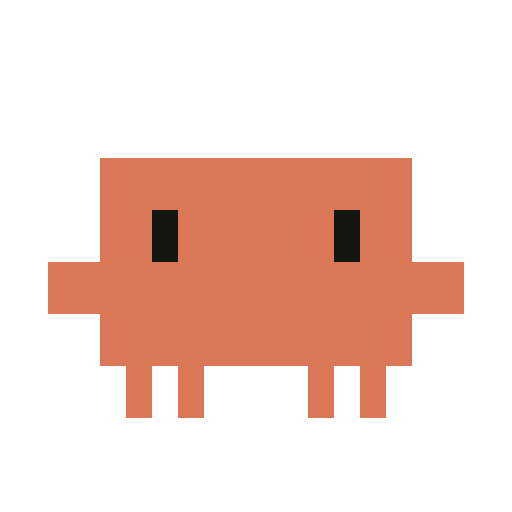

# Clawd Pet

Pixel-art Clawd that lives in the corner of your screen and shows what Claude Code is doing,
like the pets in ChatGPT/Codex. Windows, works with the Claude desktop app and the Claude Code CLI.

Пиксельный Clawd в углу экрана, который показывает, что сейчас делает Claude Code: статус,
ответы, мысли и запросы разрешений. Для Windows, работает с приложением Claude (вкладка Code)
и с Claude Code в терминале.

> Неофициальный фанатский проект. Clawd — маскот Claude Code от Anthropic; проект с Anthropic не связан.



## Установка

Скачай `ClawdPet-Setup.exe` со страницы [Releases](https://github.com/KotikVanil/clawd-pet/releases/latest)
и запусти. Установка идёт в профиль пользователя, права администратора не нужны.
Есть и `ClawdPet-portable.zip`: распакуй куда угодно и запусти `ClawdPet.exe`.

Windows может предупредить, что файл без подписи: «Подробнее» → «Выполнить в любом случае».

## Что умеет

- **Мини-пузырь**, пока Claude работает: «думаю…», «читаю main.js», «› npm install»,
  «жду тебя», «готово!», а если в транскрипте есть текст размышлений, то и его.
- **Левый клик по Clawd** открывает последний ответ Claude (markdown, код, списки).
  Клик по пузырю разворачивает ответ целиком.
- **Правый клик** по Clawd или пузырю открывает этот чат в приложении Claude.
- **Разрешения прямо на пузыре**: команда или дифф и кнопки «Разрешить / Всегда / Отклонить».
  «Ответить в приложении» или × отдают вопрос обратно в Claude.
- **Анимации**: печатает, пока работает, прыгает с конфетти, когда готово, машет «!», когда
  ждёт тебя, x_x при ошибке, засыпает, если долго ничего не происходит.
- **Наведи курсор**: поздоровается и будет следить глазами. **Води туда-сюда**: погладишь,
  он покраснеет и замурчит.
- **Перетаскивай** куда угодно, место запоминается.
- **Трей**: показать или спрятать, за каким чатом следить (самый активный или конкретный),
  поверх всех окон, автозапуск, разрешения через Clawd, обновления с GitHub.

## Как это работает

- Статусы и ответы: питомец только читает транскрипты `~/.claude/projects/*/*.jsonl` и лог
  приложения Claude. Следит за чатом с самым свежим сообщением и не перескакивает, пока текущий
  чат занят.
- Разрешения: хук `PermissionRequest` (`clawd-hook.exe`, 170 КБ, Rust) в `~/.claude/settings.json`.
  Хук спрашивает питомца через `127.0.0.1` с токеном, который меняется при каждом запуске.
  Если питомец не запущен, хук сразу пропускает запрос, и Claude показывает обычный диалог.
  Пока хук ждёт ответа (до 2 минут), собственный диалог Claude не появляется.
  Выключить можно в трее: «Разрешения через Clawd». Тогда хук убирается из настроек.
  Перед первой правкой `settings.json` сохраняется копия `settings.json.clawd-backup`.

## Сборка

Нужны Node 22, Rust (MSVC) и Python 3 с Pillow.

```
npm install
npm start          # запуск из исходников
npm run demo       # все состояния по кругу на фейковой сессии
npm run probe      # что питомец сейчас видит
powershell -ExecutionPolicy Bypass -File build.ps1   # dist\ClawdPet-Setup.exe и portable zip
```

Структура:

- `src/` — приложение (Electron): `watcher.js` читает транскрипты и лог, `permissions.js` —
  локальный сервер для хука, `hooksync.js` прописывает хук, `renderer/clawd.js` рисует
  и анимирует Clawd.
- `hook/` — хук разрешений на Rust.
- `installer/` — установщик на Tauri 2: самораспаковывающийся exe, тот же Clawd на экране,
  удаление через «Приложения» в Windows.
- `tools/` — иконки, упаковка.

## Лицензия

MIT
